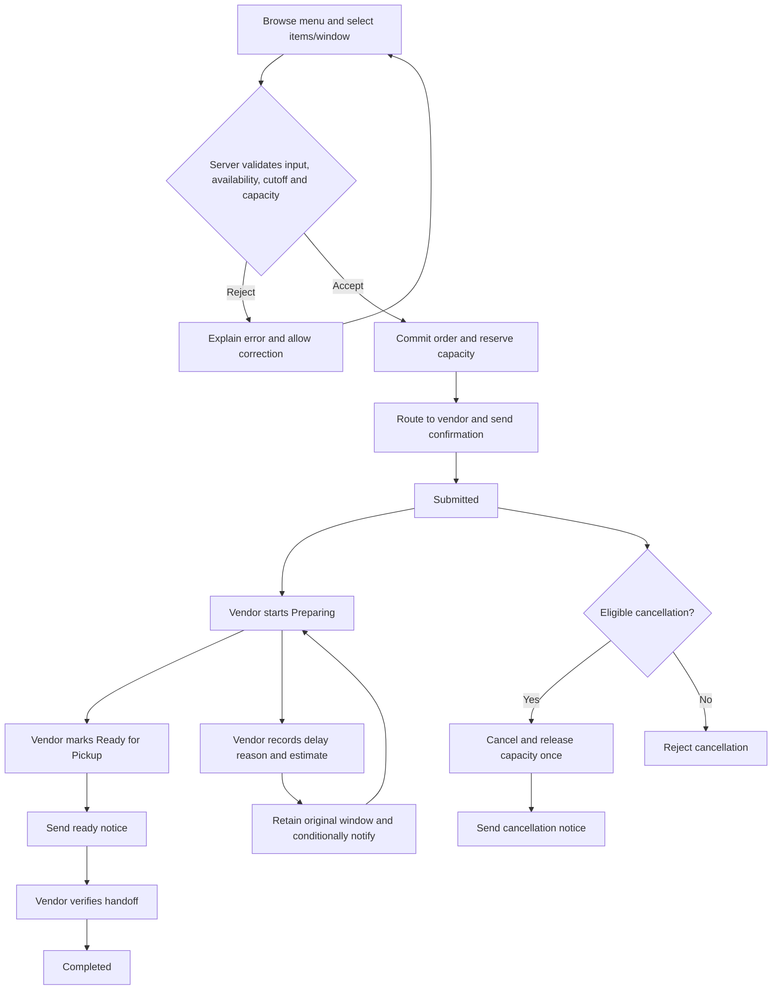
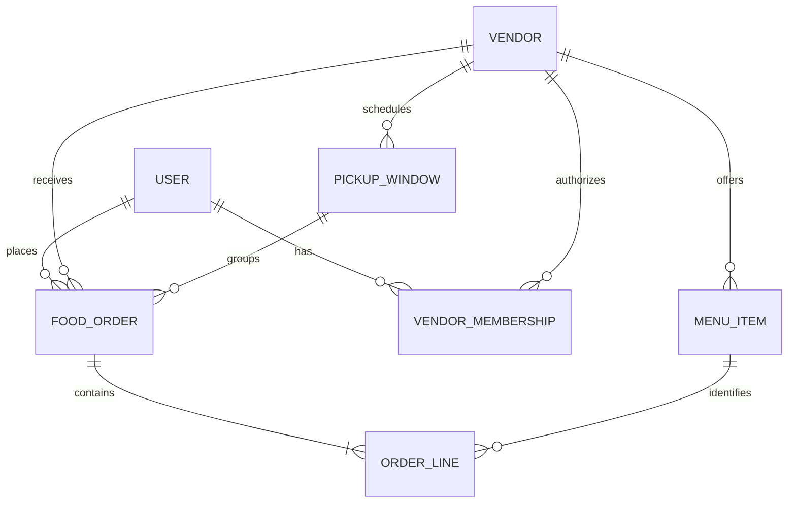

# CafeNow MVP: feature tasks and business processes

NowServing Solutions | Updated November 1, 2026

This file owns the **47 detailed task definitions**, BP01–BP10 process guidance and concrete ServiceNow component examples. [Requirements and checklist](REQUIREMENTS-AND-CHECKLIST.md) owns the candidate R01–R10 baseline. [DECISIONS.md](../../DECISIONS.md) records approvals; the shared ServiceNow MVP VTB holds live owners, dates, lanes and evidence.

For presentation: walk through the business process, explain supporting components, then select tasks. The [board guide](WEEK-ONE-BOARD.md) defines lanes/labels, card format and W01–W12 work packages. P01–P03 are reported on the VTB; that does not establish completion. Product design, interface and module availability remain pending P01–P03.

- [Business processes and automation](#business-processes-to-diagram-and-automate)
- [Component guide and examples](#servicenow-component-guide-with-concrete-cafenow-examples)
- [Requirement-to-task traceability](#requirement-to-task-traceability)
- [Pickup task definitions](#pickup-tasks-grouped-by-servicenow-feature)
- [Pickup order](#pickup-order-and-existing-board-alignment)

## Business processes to diagram and automate

Use one request-to-fulfillment overview and detailed exception diagrams. Suggested swimlanes: Employee, CafeNow system, Vendor staff/manager; add Admin for setup/exceptional correction. Human activities and system activities should appear separately.

| Process                       | Diagram path                                                                                                         | Decisions/exceptions to show                                                     | Automation to implement                                                                              |
| ----------------------------- | -------------------------------------------------------------------------------------------------------------------- | -------------------------------------------------------------------------------- | ---------------------------------------------------------------------------------------------------- |
| BP01 Maintain menu            | Manager edits → validates → publishes/changes availability → employee browses                                        | Wrong vendor, missing/invalid data, changes after order placed                   | Human-led; server validation/ACLs (D02, V01). No separate Flow Designer flow needed                  |
| BP02 Configure pickup windows | Manager/admin defines window/capacity/cut-off → validates → offers window                                            | Invalid dates/units, overlap policy, edits with existing orders                  | Human-led setup with server rules (D04). Recurring generation deferred unless required               |
| BP03 Submit and accept order  | Employee selects → server validates → reserves capacity/commits order and lines → routes → confirms                  | Full/late/unavailable, mixed vendor, repeat submission, partial failure/recovery | Server validation/booking B01–B02; **F01** accepted-order routing/confirmation                       |
| BP04 Prepare and hand off     | Vendor reviews queue → starts preparing → marks ready → employee collects → vendor verifies order number → completes | Invalid transition, delay, unable to fulfill, no-show                            | Human status decisions; server guards/timestamps B03; **F01** ready notice; completion feeds reports |
| BP05 Employee cancellation    | Requests cancellation → checks actor/state/cut-off → cancels/releases → notifies                                     | Too late, preparing/terminal, repeated request                                   | Server B04; **F02** accepted-cancellation notice                                                     |
| BP06 Vendor cancellation      | Vendor enters reason → validates authorization/state → cancels/releases per policy → notifies                        | Wrong vendor, missing reason, disallowed state                                   | Server B04; reuse **F02**, preserve initiator/reason                                                 |
| BP07 Delay handling           | Vendor records reason/estimate → validates → retains original window → updates My Orders → conditionally notifies    | Invalid estimate, immaterial change, retry, clearing delay                       | Server B05; **F03** first/material-change notice; never auto-mark ready                              |
| BP08 Upcoming-order summary   | Schedule fires → selects vendor/window/orders → produces summary → records run                                       | No orders, duplicate run, time zone boundary, wrong audience                     | **X02 Scheduled Script Execution**, if required                                                      |
| BP09 Menu import              | Authorized user supplies CSV → maps/validates → imports good rows → reviews rejects                                  | Wrong vendor, missing key, bad price, repeated import                            | **I01–I02 import process**, if required; no additional flow by default                               |
| BP10 Review operations        | Authorized viewer selects period/vendor → reports aggregate data → reviews findings                                  | No data, inconsistent units, cross-vendor access                                 | A01–A02 reports; no separate flow required                                                           |

### Main-process discussion sketch

P02 must approve the policy details. Diagram vendor cancellation separately until its permitted source states are agreed. Do not invent automatic no-show completion.

## ServiceNow component guide with concrete CafeNow examples

Use this guide when refining the existing task cards. These examples describe proposed configuration, not installed components. Names, sample data, capacities and times below are illustrative; P02/P03 must settle business rules and architecture. Keep the existing task IDs and add the relevant components to each card's implementation notes and acceptance checks.

Catalog, catalog item, request and portal are separate components. Choose whether a native Requested Item or custom Food Order is authoritative before building. Do not automatically create both as competing sources. Catalog coverage must still be agreed with the instructor if custom ordering is selected.

### Foundation, access and user experience

| Component                                   | Concrete CafeNow example                                                                                                                                                                                                                                     | Task / process mapping        | Verification / inclusion                                                                                                                       |
| ------------------------------------------- | ------------------------------------------------------------------------------------------------------------------------------------------------------------------------------------------------------------------------------------------------------------ | ----------------------------- | ---------------------------------------------------------------------------------------------------------------------------------------------- |
| Users                                       | Seed Employee A and Employee B, staff for Vendor A and Vendor B, a vendor manager and an app admin. Employee A places a sample lunch order.                                                                                                                  | S02, D05; BP03–BP07           | Core: repeat the same journey with separate identities; never demonstrate employee permissions only as admin                                   |
| Roles                                       | Proposed employee persona can read own orders; vendor staff can perform preparation/handoff actions; vendor manager can edit own menu. Actual scoped role identifiers remain undecided.                                                                      | S01–S04; BP01, BP04           | Core: verify allowed and denied actions; assigning a role alone does not complete security                                                     |
| Groups and vendor membership                | A proposed CafeNow Vendor A Fulfillment group contains Vendor A's staff and maps explicitly to Vendor A. An accepted Vendor A order routes to that vendor's fulfillment audience.                                                                            | S02, F01; BP03–BP04           | Core: Vendor B staff cannot obtain Vendor A access by changing a submitted vendor/group value                                                  |
| Tables, dictionary fields and references    | Logical Order references Employee A, Vendor A and the 12:00–12:15 window. Two Order Lines contain 2 sandwiches at a captured unit price of $8 and 1 salad at $7: sample total $23.                                                                           | D01–D04; BP02–BP04            | Core: later menu price changes do not rewrite this order's captured prices; map entities to chosen native/custom records                       |
| Service Portal / chosen employee interface  | Employee A opens CafeNow, browses Vendor A's available menu, selects a pickup window, submits and opens My Orders to see a revised ready estimate.                                                                                                           | U01–U03; BP03, BP05, BP07     | Core employee experience; Service Portal technology conditional on P03. Verify desktop/tablet and protected direct links                       |
| Service Catalog and category                | If catalog ordering is selected, expose a CafeNow catalog/category with a Place Meal Order entry for eligible employees.                                                                                                                                     | C01; BP03                     | Conditional architecture/checklist coverage: verify the intended audience and absence of a second competing ordering path                      |
| Catalog item and variables                  | Place Meal Order captures vendor, menu lines/quantities, pickup window and permitted instructions such as No onions. Choose the supported multi-line input design during P03/C02.                                                                            | C02, U02; BP03                | Conditional on catalog design: correct inputs captured; mixed-vendor and invalid quantities still rejected server-side                         |
| Request / Requested Item records            | In a catalog-centered design, the Request is the submission container and the selected Requested Item represents the authoritative meal order. Define where all line and fulfillment data belongs; do not create an independently managed custom order copy. | C03, D03; BP03–BP04           | Conditional on P03: one submission has one accepted fulfillment order and one lifecycle owner; native/custom state mapping explicitly reviewed |
| Vendor lists, forms and related order lines | Vendor A staff open an Upcoming Orders list grouped by pickup window/status and inspect an order's lines and instructions. A batch summary shows 15 sandwiches while preserving each order's customization.                                                  | V02–V03; BP04                 | Core: totals reconcile to known records, cancelled-order counting is defined, and Vendor B's records are inaccessible                          |
| ACLs                                        | Employee A cannot read Employee B's order or lines, including through direct access. Vendor A staff cannot edit Vendor B's menu or change a protected captured price.                                                                                        | S03–S04, T07; BP01, BP03–BP07 | Core: test table/record/field permissions and report visibility; hiding a button or filtering a list is insufficient                           |

### Validation, actions and automation

| Component                                      | Concrete CafeNow example                                                                                                                                                                                                 | Task / process mapping             | Verification / inclusion                                                                                                                          |
| ---------------------------------------------- | ------------------------------------------------------------------------------------------------------------------------------------------------------------------------------------------------------------------------ | ---------------------------------- | ------------------------------------------------------------------------------------------------------------------------------------------------- |
| Business Rules                                 | On a supported order write path, server validation rejects quantity 0, rejects a Vendor B item on a Vendor A order and blocks Completed → Preparing. Apply guards to all relevant parent/line write paths.               | B01, B03–B05; BP03–BP07            | Core server behavior; exact rule implementation depends on P03. Direct write attempts must not bypass validation                                  |
| Script Includes                                | A proposed shared CafeNowOrderService contains eligibility/transition logic. An employee cancellation action and another supported server entry point invoke the same cancellation service instead of copying the rules. | B01–B05; BP03–BP07                 | Use where logic is reused: all entry points apply the same actor, cut-off and release-once checks; example name is not an approved identifier     |
| UI Policies / Catalog UI Policies              | On a vendor form, show delay reason and revised estimate when delay is selected; on the catalog item, guide required pickup inputs using the policy type supported by that interface.                                    | C02, U02–U03, V02, B05; BP03, BP07 | Include where useful: verify show/hide/mandatory behavior in chosen UI. Repeat essential validation server-side; UI policies are not ACLs         |
| Reference qualifiers                           | After Vendor A is selected, an item reference offers only Vendor A's published/available items and a pickup-window reference offers eligible Vendor A windows.                                                           | C02, U02, D02–D04; BP03            | Include if reference inputs are used: changing vendor refreshes choices. Server rechecks stale/unavailable selections and capacity at submission  |
| Validated actions / UI Actions where supported | A Mark Ready action requests Preparing → Ready for Pickup. A Cancel Order action requests cancellation rather than letting an employee directly edit status.                                                             | U03, V02, B03–B04; BP04–BP06       | Core actions, interface-specific component: visible only where appropriate, with authorization/state validation repeated on the server            |
| Flow Designer                                  | After an accepted Vendor A order commits, route it to Vendor A and initiate confirmation. When authorized staff mark it ready, initiate the ready notice. Cancellation and delay use F02/F03.                            | F01–F03; BP03–BP07                 | Core orchestration: record execution evidence; rejected submissions do not route or send success notices; do not automatically mark food ready    |
| Email notifications and event triggers         | A ready notice to Employee A includes order number, Vendor A pickup location, pickup details and a protected My Orders link. First/material delay changes send reason and revised estimate.                              | N01–N02, F01–F03; BP03–BP07        | Core: one intended email per qualifying event; unrelated edits do not resend; verify recipient/link and distinguish generated email from delivery |
| Scheduled Script Execution                     | Illustrative schedule: every 15 minutes in the agreed time zone, produce each vendor's summary for the next 30 minutes. Exclude terminal orders and avoid duplicate output for the same vendor/run window.               | X01–X02; BP08                      | Conditional on instructor requirement; exact schedule/output agreed first. Test reruns, empty periods and vendor isolation                        |

Capacity example for B02/T03: if the approved unit is meals and a window has capacity 20 with 19 reserved, submit two simultaneous one-meal orders. Exactly one may reserve the remaining unit. A failed submission must not leave a capacity reservation or a fulfillable partial order. A Business Rule, Script Include or flow name alone does not prove concurrency safety; select and test a supported atomic design before claiming this passes.

### Integration, reporting and testing

| Component                              | Concrete CafeNow example                                                                                                                                                               | Task / process mapping                | Verification / inclusion                                                                                                                                                                                  |
| -------------------------------------- | -------------------------------------------------------------------------------------------------------------------------------------------------------------------------------------- | ------------------------------------- | --------------------------------------------------------------------------------------------------------------------------------------------------------------------------------------------------------- |
| Import Sets                            | Load an illustrative menu CSV into staging with vendor_code, item_code, name, price and available. A row with a negative price is rejected with a usable error.                        | I01–I02; BP09                         | Conditional integration coverage: authorized upload, valid/invalid row evidence and explicit validation before target changes                                                                             |
| Transform Maps                         | Map CSV fields to the chosen menu records, resolve vendor_code to Vendor, and use an agreed stable vendor/item key to update an existing sandwich instead of creating a duplicate.     | I01–I02; BP09                         | Conditional with import: repeat the same file and verify intended update behavior; unauthorized vendor changes fail; required validation must not be bypassed by import settings                          |
| Reports                                | For a known 20-meal-capacity window with 15 reserved meals, show 75% utilization if P02/A01 adopt that definition. Show order counts separately: meals and orders are different units. | A01–A02, T08; BP10                    | Core: numerator/denominator, cancelled-state handling, period boundaries and vendor access documented and checked                                                                                         |
| Dashboard                              | A proposed Lunch Operations dashboard combines Orders by Status, Upcoming Vendor Workload and Pickup-Window Utilization. Vendor A's view includes only its permitted data.             | A02, T07–T08; BP10                    | Core basic reporting presentation: reconcile each visualization and ensure no employee details leak through aggregate/drill-down views                                                                    |
| Automated Test Framework (ATF)         | Where the chosen interface/test steps are supported, automate a valid order scenario and invalid quantity cases using 0 and -1. Assert expected outcomes and clean up/reset test data. | T01–T05, T07, T10                     | Selective automation after the basic journey works; verify step support in the instance. Separate manual/other test evidence remains necessary for unsupported cases and true simultaneous-capacity tests |
| Visual Task Board (team delivery tool) | Card B04 — Implement cancellation contains the agreed rule, owner/reviewer, dependencies and T05 evidence; it moves to Done only after review/test.                                    | All delivery tasks; W01–W12 alignment | Project coordination, not the application's vendor food queue. Use one MVP board; week-one work is a selected subset                                                                                      |

### Worked example: one business action across components

Proposed employee cancellation connects the components as follows:

1. Employee A opens their order through the portal/My Orders interface, protected by ACLs.
2. A supported action offers cancellation when appropriate; UI visibility is a usability aid.
3. Server-side logic, shared through a Script Include where appropriate, checks identity, current status and cut-off using the agreed policy.
4. On success, the authoritative order changes to Cancelled with reason/actor/timestamp and capacity releases exactly once using the B02/B04 design. On failure, return a rejection and preserve the order/capacity.
5. F02 initiates the cancellation notice through the chosen single notification owner; it does not repeat the capacity release.
6. Reports follow their defined cancellation counting rules. T05/T06/T07 verify timing, repeat requests, recipient and access restrictions.

This work stays on B04/F02 and related test cards. The component list clarifies implementation; it does not introduce a separate business feature or duplicate delivery card for every configuration record.

### Official implementation references

Consult the documentation version matching the training instance during P03. These references support component responsibilities, not the unverified CafeNow implementation.

- [Business Rules and Script Includes](https://www.servicenow.com/docs/r/application-development/business-rules-and-script-includes.html): shared server logic and entry points.
- [UI Policies learning module](https://developer.servicenow.com/print_page.do?category=learning-module&identifier=CSS_About_zurich%2Cnew_to_servicenow&module=learning+plan&release=zurich): conditional form behavior; verify interface support.
- [Reference qualifiers](https://www.servicenow.com/docs/r/platform-administration/c_ReferenceQualifiers.html): filtering reference choices.
- [Transform Maps](https://www.servicenow.com/docs/r/integrate-applications/system-import-sets/t_CreateATransformMap.html): staging-to-target field relationships.
- [ATF parameterized datasets](https://www.servicenow.com/docs/r/application-development/automated-test-framework-atf/add-parameterized-data.html): repeating tests with different inputs.

## Requirement-to-task traceability

Requirement meanings, acceptance examples and checklist explanations are maintained in [REQUIREMENTS-AND-CHECKLIST.md](REQUIREMENTS-AND-CHECKLIST.md). Use the mapping below to attach task/evidence links to requirements. Supporting tasks may serve several requirements.

| Requirement | Related task IDs                                 |
| ----------- | ------------------------------------------------ |
| R01         | D02, S04, U01, U02, V01, B01, T02                |
| R02         | D03, D04, C01–C03 if chosen, U02, B01, B02, T02  |
| R03         | D04, B01, B02, T03                               |
| R04         | S03, V02, V03, F01, T04                          |
| R05         | D03, U03, B03, F01, T04, T07                     |
| R06         | P02, B04, B05, U03, F02, F03, T05                |
| R07         | F01–F03, N01, N02, T06                           |
| R08         | S01–S04, T07                                     |
| R09         | D03, D04, A01, A02, T08                          |
| R10         | D05, T01, T09, T10; X02/I02 evidence if required |

## Pickup tasks grouped by ServiceNow feature

These are task definitions, not live status. Preserve existing VTB ownership/progress. Add new cards to Backlog and apply the [readiness and card rules](WEEK-ONE-BOARD.md#task-card-template) before pickup. Dependencies below gate completed implementation; design investigations can be time-boxed while details are being resolved. Every build task needs relevant checks and peer review before Done. Split large tasks into linked increments without losing requirement coverage.

### Process design and environment

| ID  | Task                                                                       | Depends on | Acceptance output                                                                                                                                                      |
| --- | -------------------------------------------------------------------------- | ---------- | ---------------------------------------------------------------------------------------------------------------------------------------------------------------------- |
| P01 | Confirm scope, deadline, availability, authority and checklist obligations | None       | Governing source, MVP/deferrals, deadline/demo requirements, team capacity and decision authority recorded with approval/source                                        |
| P02 | Define rules and business-process diagrams                                 | P01        | Transition matrix; capacity units, cut-off, cancellation/release, no-show, time zone and material delay-change policy and menu-change handling agreed                  |
| P03 | Verify instance and choose architecture/interface                          | P01        | Access/modules checked; authoritative order, catalog/request mapping, UI and configuration transfer/review method documented; feasibility findings reconciled with P02 |

### Tables, columns and relationships

These are logical entities, not approved custom table names. Map to native/custom records after P03; do not create custom copies automatically.

#### Proposed table design for team review — November 2

Source: the [proposal's preliminary data model](../proposals/ServiceNow_OMS_Project_Proposal.md#4-preliminary-data-model), refined during the November 2 table discussion. This is a recommendation for P03/D01/S01, not architecture approval or observed configuration. Actual scoped names, release support and table entitlements remain unverified. The [decision record](../../DECISIONS.md) governs confirmed team rules.

**Extend** means inherit fields and behavior from a parent table. **Reference** means link to an existing record; an order references an employee rather than extending User. See ServiceNow's [table relationships](https://www.servicenow.com/docs/r/platform-administration/table-administration-and-data-management/table-relationships.html) and [data-model guidance](https://www.servicenow.com/docs/r/application-development/build-data-model.html). Validate against the target release during P03.

| Entity | Proposed reuse/create/extend choice | Design qualification |
| --- | --- | --- |
| Employee, vendor staff, manager, admin | Reuse User (`sys_user`) records | Do not extend User to represent a vendor business; link people through membership or an agreed group model |
| Organization / Building | Reuse an appropriate existing location record or minimal pilot configuration | One building does not require a new organization/subscription model |
| Cafeteria Vendor | Create standalone table | Five vendor records, not five tables |
| Menu Item | Create standalone table if custom menu data is authoritative | Settle catalog mapping first; avoid independent conflicting menu/price sources |
| Food Order | Investigate a custom table extending Task, or reuse native Requested Item | Choose one authoritative order; Task inheritance is optional and requires review of inherited behavior, fields and ACLs |
| Order Line Item | Create standalone table for the custom-order design | One record per ordered item/quantity/price snapshot |
| Pickup Window | Create standalone table | Vendor-specific start/end and capacity |
| Vendor Membership | Create linking table if needed | User/vendor references plus responsibility; an agreed group model may replace it |
| Inventory, Waste Entry, Supplier, Purchase Record, Subscription | Defer | No MVP tables required for these future entities |

Suggested field dictionary (logical names only):

| Table | Fields and types |
| --- | --- |
| Vendor | name: String; active: Boolean; location: Reference if reusing locations; manager: User reference; operating-hours configuration if required |
| Vendor Membership | vendor: Vendor reference; user: User reference; responsibility: Choice (staff/manager); active: Boolean; prevent duplicate membership for the same user/vendor under the agreed model |
| Menu Item | vendor: Vendor reference; name/description: Text; price: agreed monetary type/currency; category: Choice or Reference; published/available: Boolean; vendor-maintained allergen information/dietary tags |
| Pickup Window | vendor: Vendor reference; start/end: Date/Time; capacity: Integer once consumption units are agreed; ordering/cancellation deadlines: derive from start or store consistently under an agreed edit policy |
| Food Order | employee: User reference; vendor: Vendor reference; pickup_window: Pickup Window reference; number/state: reuse inherited fields if appropriate; submitted/confirmed/preparing/ready/picked-up/cancelled timestamps: Date/Time; cancellation actor: User reference; cancellation reason: Text; delay flag: Boolean; delay reason: Text; estimated ready time: Date/Time; captured total: monetary value |
| Food Order, proposed evidence fields | terms version: String; acknowledgement timestamp: Date/Time, if adopted; reminder/disposal tracking fields only after the no-show policy is defined |
| Order Line | order: Food Order reference; menu_item: Menu Item reference; quantity: Integer; captured_unit_price: monetary value; item_name_snapshot: String; instructions: Text |

Do not duplicate inherited number, state, assignment or audit fields automatically. Membership responsibility does not itself grant permissions; S01/S03/S04 must define and enforce access. Exact choice values, mandatory fields, indexes, deletion rules and currency precision belong in the reviewed D01 dictionary.

The reference belongs on the many side: Menu Item references Vendor, Order Line references Food Order, and Food Order references employee/vendor/window. A submitted order must have at least one line; creation must avoid leaving a partial accepted order. Keep historical lines when menus change; agree archive/delete behavior rather than silently removing referenced records.

Server-side integrity and acceptance checks:

- Every line's menu item and the selected window belong to the order's vendor; reject mixed-vendor input and forged references.
- Capture unit prices and item names at submission; later menu edits must not rewrite order history. Compute totals from validated quantities and captured prices.
- Ordering closes 30 minutes before pickup-window start; employee cancellation closes 20 minutes before start. Show the cancellation rule in terms before submission. Resolve exact-boundary inclusivity and cancellation-eligible states before implementation.
- Vendor service portal shows Submitted orders by window; vendors confirm individually or batch-confirm eligible orders. Server checks vendor ownership and current state per order, prevents duplicate side effects and reports confirmed/skipped/failed results. Test concurrent cancellation versus batch confirmation; agree atomic versus partial-success behavior. Vendors control subsequent fulfillment; Closed Complete means actual pickup. Three no-show notices have 30-minute intervals; final disposal warning is one hour before vendor closing. Define initial trigger, scheduling conflicts and actual disposal/no-show closure separately.
- Capacity is 20 orders per vendor pickup window; window duration, reservation timing and release rules remain open. The 30-minute interval applies to no-show notices, not window duration. Test simultaneous last-unit booking and release exactly once.
- Test employee ownership, cross-vendor denial and authorized all-vendor admin access beyond UI filters, including reports.

**Catalog mapping investigation:** consider one CafeNow catalog with five vendor categories as a proposed presentation structure, not an approved choice. Native Catalog Items (`sc_cat_item`) and request records are distinct from custom menu/order records. A Record Producer can create an application-specific record; verify the supported interface and multi-line submission design in the target instance. See [Service Catalog guidance](https://www.servicenow.com/docs/r/servicenow-platform/service-catalog/request-cat-use-case.html).

The recommended feasibility investigation is one vendor ordering entry point selecting multiple menu items and producing one Food Order with lines. An alternative is one catalog item per food item, which requires defining how requested items are grouped into one vendor order. Compare against native request-centered ownership; do not maintain independently editable Requested Item and Food Order lifecycles. Confirm instructor acceptance of the selected Catalog approach.

P03 supplies a feasible order/catalog/interface choice; D01 supplies the reviewed dictionary and relationships; S01 supplies the access matrix. D02–D04 implement only the approved model, S02 supplies personas, and D05/T01 cover five vendors in the full MVP seed/test plan (a two-vendor slice is an intermediate test).

| ID  | Task                                       | Depends on   | Acceptance output                                                                                                                               |
| --- | ------------------------------------------ | ------------ | ----------------------------------------------------------------------------------------------------------------------------------------------- |
| D01 | Review dictionary and relationship diagram | P02, P03     | Fields, mandatory values, references, ownership, units and scoped names agreed; minimal building configuration defined                          |
| D02 | Configure vendor/menu data                 | D01          | Vendor/location, published/available flags, price and vendor-owned dietary/allergen fields                                                      |
| D03 | Configure order/order lines                | D01          | Employee/vendor/window links, quantity, price snapshot, instructions, lifecycle timestamps, cancellation/delay fields; original window retained |
| D04 | Configure pickup-window data               | D01          | Vendor/start/end/cut-off/capacity and consumption in agreed units/time zone; invalid configuration rejected                                     |
| D05 | Create repeatable seed data                | D02–D04, S02 | Five vendors for full MVP; two-vendor intermediate slice permitted; multiple items/windows, open/full/late scenarios, known orders and setup/reset notes |

### Users, roles, groups and access controls

| ID  | Task                                                      | Depends on   | Acceptance output                                                                                                 |
| --- | --------------------------------------------------------- | ------------ | ----------------------------------------------------------------------------------------------------------------- |
| S01 | Define persona/action/access matrix                       | P02, P03     | Employee, vendor staff/manager and app admin rules; building/management reporting explicitly included or deferred |
| S02 | Configure test users, roles, groups and vendor membership | S01, D01     | Two employees, staff for vendors A/B, manager/admin coverage; membership documented without credentials           |
| S03 | Implement ownership and read/create ACLs                  | S02, D02–D04 | Orders/lines/references protected; direct access restricted; employee/vendor ownership cannot be forged           |
| S04 | Protect updates, actions, menus and reports               | S03          | Unauthorized price/vendor/status changes denied; vendor/menu/report permissions match matrix                      |

### Service Catalog, catalog items and requests

Conditional on P03. If custom ordering is selected, replace this section's tasks with the approved catalog-coverage approach. Request records or fulfillment tasks are included only where the chosen architecture needs them.

| ID  | Task                                        | Depends on         | Acceptance output                                                                                                                          |
| --- | ------------------------------------------- | ------------------ | ------------------------------------------------------------------------------------------------------------------------------------------ |
| C01 | Configure agreed catalog/category/audience  | P03, S02           | Eligible employees locate ordering; restricted entry points protected                                                                      |
| C02 | Configure ordering item and inputs          | C01, D02–D04       | Vendor, multiple items/quantities, pickup window and instructions captured; required inputs usable                                         |
| C03 | Connect submission to order and fulfillment | C02, B01, B02, S03 | Native request mapping if used documented; one accepted order, single lifecycle owner; rejected input creates no fulfillable partial order |

### Employee Service Portal / chosen interface

| ID  | Task                                    | Depends on                               | Acceptance output                                                                                   |
| --- | --------------------------------------- | ---------------------------------------- | --------------------------------------------------------------------------------------------------- |
| U01 | Sketch browse/order/track journey       | P02, P03                                 | Desktop/tablet sketches include full slot, invalid input, cancellation and delay                    |
| U02 | Build menus and order entry             | U01, D02–D04, S03, B01, B02; C03 if used | Published vendor menus/labels; one-vendor lines/window; successful confirmation or useful rejection |
| U03 | Build My Orders and cancellation action | U02, B03–B05, S04                        | Own details/status, original window/revised estimate and cancellation outcome displayed securely    |

### Vendor interface: lists, forms and queue

| ID  | Task                                   | Depends on    | Acceptance output                                                                                      |
| --- | -------------------------------------- | ------------- | ------------------------------------------------------------------------------------------------------ |
| V01 | Build menu maintenance                 | D02, S04      | Authorized manager maintains own menu/labels/availability; unauthorized edits fail                     |
| V02 | Build queue, detail and status actions | D03, S04, B03 | Own orders grouped/filterable by window/status; individual instructions and allowed actions accessible |
| V03 | Add batch preparation totals           | V02           | Quantities by vendor/window/item reconcile; cancellation/state inclusion follows agreed policy         |

### Server-side business rules and validation

Choose supported implementation methods during design. UI filtering is an aid, not final validation. Capacity reservation/release needs a concurrency-safe design; an asynchronous flow or unprotected count-then-insert is insufficient.

| ID  | Task                                            | Depends on        | Acceptance output                                                                                                   |
| --- | ----------------------------------------------- | ----------------- | ------------------------------------------------------------------------------------------------------------------- |
| B01 | Validate input, availability and cut-off        | P02, D02–D04, S03 | Invalid/missing/mixed-vendor/late/unavailable input rejected; employee identity/prices checked server-side          |
| B02 | Reserve capacity and recover failed submissions | B01               | Last-unit concurrency test passes; partial failures do not leak capacity; repeat-submit/idempotency policy verified |
| B03 | Enforce lifecycle and timestamps                | P02, D03, S01     | Actors/transitions validated; timestamps recorded; Completed/Cancelled terminal in ordinary actions                 |
| B04 | Implement cancellation and release              | B02, B03, S01     | Own Submitted employee order before cut-off; vendor reason/state rules enforced; release happens once               |
| B05 | Implement delay updates                         | B03, S01          | Authorized reason/estimate retained with original window; material-change and delay-clear policy applied            |

### Flow Designer and email

Validation/commit happens before accepted-order follow-up. Assign one sender per event so flow and notification configurations do not both send duplicate notices.

| ID  | Task                                                | Depends on    | Acceptance output                                                                                            |
| --- | --------------------------------------------------- | ------------- | ------------------------------------------------------------------------------------------------------------ |
| N01 | Define event/recipient/template matrix              | P02, D03      | Confirmation, ready, cancellation, delay; pickup details/reason/estimate/link, deduplication and retry rules |
| F01 | Automate accepted-order routing and ready follow-up | B02, B03, N01 | Correct vendor routing and confirmation/ready events once; elapsed time never implies food is ready          |
| F02 | Automate accepted-cancellation follow-up            | B04, N01      | Successful cancellation triggers notice; rejected request does not send success email                        |
| F03 | Automate delay follow-up                            | B05, N01      | First/material-change notice only; unrelated edits/retries do not duplicate                                  |
| N02 | Configure and inspect email outputs                 | N01, F01–F03  | Correct generated event/recipient/protected link; actual outbound delivery state recorded separately         |

### Scheduled Script Execution and integration

| ID  | Task                                                 | Depends on    | Acceptance output                                                                                             |
| --- | ---------------------------------------------------- | ------------- | ------------------------------------------------------------------------------------------------------------- |
| X01 | Confirm exact scheduled/import checklist obligations | P01, P03      | Instructor decision on mechanism, minimal behavior, evidence and deferrals; reuse sufficient P01/P03 findings |
| X02 | Build upcoming-order summary if required             | X01, V02, S04 | Time zone/frequency/window/state filters; vendor isolation; reruns do not duplicate; execution evidence       |
| I01 | Specify menu CSV mapping/validation if required      | X01, D02, S04 | Columns, vendor ownership, update key, invalid-row and repeat-import behavior defined                         |
| I02 | Configure and test bounded import                    | I01           | Intended rows create/update; invalid rows reported; no cross-vendor changes or unintended repeat duplicates   |

### Reports and dashboards

| ID  | Task                              | Depends on         | Acceptance output                                                                                      |
| --- | --------------------------------- | ------------------ | ------------------------------------------------------------------------------------------------------ |
| A01 | Define metrics and audiences      | P02, D03, D04, S01 | Volume/fulfillment and utilization numerator/denominator, units, states and time boundaries documented |
| A02 | Build minimal operational reports | A01, D05, S04      | Known totals reconcile; role/vendor visibility enforced; unsupported metrics omitted or labelled       |

### Testing, evidence and demo

| ID  | Task                                    | Depends on                        | Acceptance output                                                                               |
| --- | --------------------------------------- | --------------------------------- | ----------------------------------------------------------------------------------------------- |
| T01 | Write cases and evidence template       | P02, P03                          | R01–R10 mapped to persona, inputs, expected/actual result, environment/tester/date and evidence |
| T02 | Test browsing/submission                | T01, U02                          | Valid/unavailable/missing/invalid/mixed-vendor/price/repeat-submit cases recorded               |
| T03 | Test capacity, cut-off and recovery     | T01, B02                          | Concurrent last-unit/full/boundary/failed-submit results recorded                               |
| T04 | Test queue, batches and lifecycle       | T01, V03, B03, U03                | Journey, instructions/totals and invalid transitions checked                                    |
| T05 | Test cancellations and delays           | T01, B04, B05, U03                | Actor/state/cut-off/reason/release-once and original-window/estimate checks                     |
| T06 | Test notices and protected links        | T01, N02                          | Events, recipients, unrelated edits, retry behavior and unauthorized-link access checked        |
| T07 | Test user/vendor/field/report isolation | T01, S04; repeat as features land | Direct reads/writes/actions/reports checked with test personas; defects retested                |
| T08 | Reconcile reports                       | T01, A02                          | Hand-counted data matches displayed totals and role visibility                                  |
| T09 | Test desktop/tablet journeys            | U03, V03                          | Employee and vendor tasks usable at agreed sizes; defects recorded/fixed                        |
| T10 | Rehearse demo and handoff               | D05, T02–T09; X02/I02 if required | Setup/personas/steps, evidence, limitations and configuration transfer notes reviewed           |

## Pickup order and existing board alignment

1. Review P01–P03 already reported on the VTB. Resolve P01, then coordinate P02 business rules with P03 platform findings.
2. Add/refine D01, S01, U01, T01 and X01 as foundation cards. Review dictionary/security together; align sketches and test cases as fields become concrete.
3. Configure data/identities and access, then deliver server validation, order entry and vendor visibility as a small integrated slice. Test immediately.
4. Add tracking, menu maintenance, batches, cancellation/delays, notices, reports and instructor-required scheduled/import/catalog coverage.
5. Rehearse verified outputs and disclose remaining defects/requirements. Completing a small week-one slice does not complete the full MVP.

The [board guide](WEEK-ONE-BOARD.md#w01w12-work-packages) owns the W01–W12 mapping; [BACKLOG.md](../../BACKLOG.md) provides a compact sequence. Keep the VTB as the sole live task tracker. Follow [PROJECT.md](../../PROJECT.md) for deferred scope and [DECISIONS.md](../../DECISIONS.md) for approved changes. No per-meal approval workflow is proposed without an explicit requirement.
